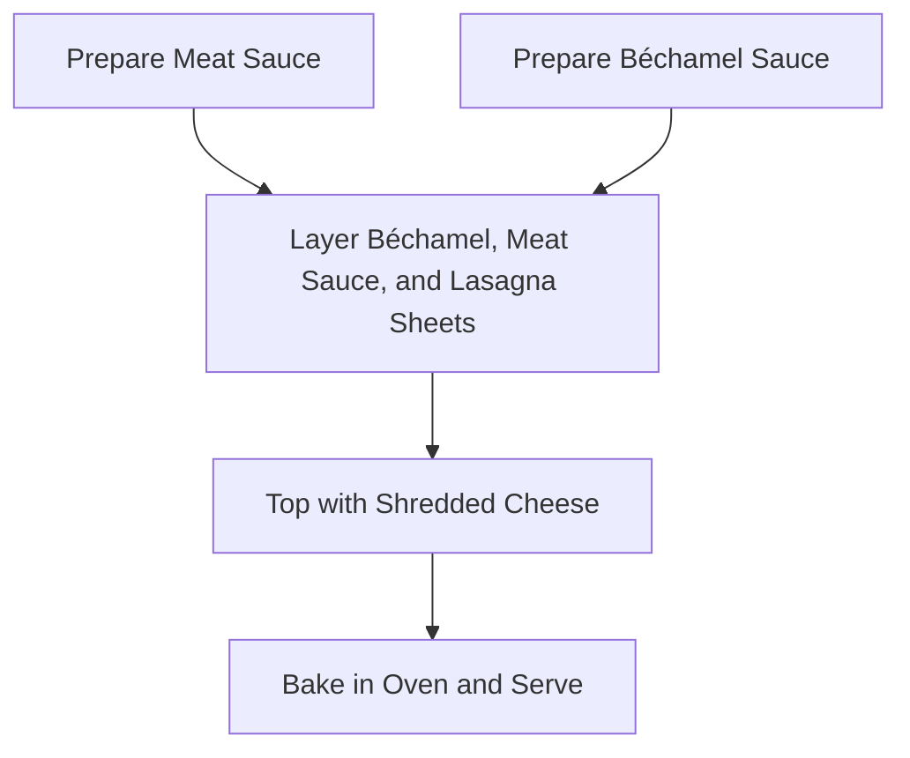

# Lasagna

> [!NOTE]
> **Recipe Summary**  
> Classic baked lasagna assembled in layers with a seasoned ground beef and tomato sauce, smooth béchamel sauce, lasagna sheets, and shredded cheese.

## Ingredients

| Ingredient | Amount | Notes |
| :--- | :--- | :--- |
| Lasagna sheets | ~10 sheets | More may be needed depending on baking dish size |
| Kashar cheese | 1 cup | Shredded (or mozzarella) |
| Ground beef | - | For meat sauce |
| Yellow onion | 1 | Diced |
| Tomato paste | 1 tbsp | For meat sauce |
| Pepper paste | 1 tbsp | For meat sauce |
| Crushed tomatoes | 1 cup | For meat sauce |
| Water | 2 cups | For meat sauce |
| Olive oil | 4–5 tbsp | For meat sauce |
| Paprika | 1 tsp | For meat sauce |
| Salt | To taste | For meat sauce and béchamel |
| Black pepper | To taste | For meat sauce |
| Butter | 1 tbsp | For béchamel sauce |
| Flour | 2 tbsp | For béchamel sauce |
| Milk | 1 cup | For béchamel sauce |
| Water | 1 cup | For béchamel sauce |
| Nutmeg | To taste | Grated (optional) |

## Instructions

{}
1. ## Prepare the Meat Sauce
   Heat olive oil (4–5 tbsp) in a wide pan. Add the diced onion (1) and sauté until softened. Add the ground beef and cook until the liquid is absorbed. Add tomato paste (1 tbsp) and pepper paste (1 tbsp), stirring until fragrant. Add paprika (1 tsp), crushed tomatoes (1 cup), salt, and black pepper, and simmer for 2–3 minutes. Pour in the water (2 cups) and simmer for another 5 minutes, then remove from heat.

2. ## Prepare the Béchamel Sauce
   Melt butter (1 tbsp) in a saucepot. Add flour (2 tbsp) and cook until the raw flour aroma dissipates. Slowly whisk in milk (1 cup) and water (1 cup). Cook over medium-low heat, whisking constantly, until thickened and smooth. Season with salt and freshly grated nutmeg (if desired) before removing from heat.

3. ## Assemble the Layers
   Starting at the bottom of the baking dish, layer béchamel sauce, meat sauce, and lasagna sheets (repeat: Béchamel -> Meat Sauce -> Lasagna Sheet).

4. ## Bake and Serve
   Spread the remaining béchamel sauce over the top layer and sprinkle evenly with shredded cheese (1 cup). Bake in a preheated oven until the lasagna sheets are tender and the cheese is golden brown and bubbly.
{}

## Workflow

## Useful Notes

> [!TIP]
> **Béchamel Aroma**  
> Grating a small amount of nutmeg into the béchamel sauce enhances the milky richness and gives the sauce a complex, comforting aroma.

> [!NOTE]
> **Sheet Quantity**  
> Depending on the dimensions of your baking dish and the number of layers, you may need more than 10 lasagna sheets. Adjust the amount to fit your pan.
