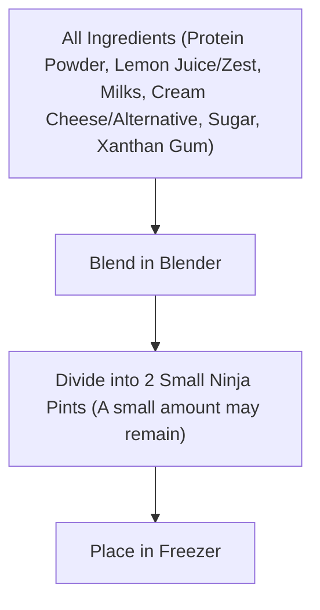

# Ninja Lemon Protein Ice Cream

> [!info] Recipe Summary
> A refreshing, high-protein ice cream recipe prepared with vanilla whey protein powder, fresh lemon juice, and zest, measured for Ninja Creami pints.

## Ingredients

| Ingredient | Amount | Notes |
| :--- | :--- | :--- |
| Protein Powder (Whey) | 54 g | Vanilla flavor |
| Lemon Zest | 1 | Finely grated |
| Lemon Juice | 1 | Freshly squeezed |
| Almond Milk | 300 ml | |
| Lactose-Free Milk | 300 ml | |
| Cream Cheese | 15 g | Alternative: 10 g clotted cream, 15 g yogurt, or 15 ml heavy cream |
| Sugar | 20 g | |
| Xanthan Gum | 1/2 tsp | Stabilizer |

## Instructions

### 1. Blending
1. Add **Protein Powder (Vanilla Whey)**, **Lemon Zest**, **Lemon Juice**, **Almond Milk**, **Lactose-Free Milk**, **Cream Cheese** (or chosen alternative), **Sugar**, and **Xanthan Gum** into a blender.
2. Blend until smooth and completely homogeneous.

### 2. Portioning into Ninja Pints
1. Divide the prepared mixture evenly between 2 small Ninja Creami pints *(a tiny amount may occasionally remain)*.
2. Seal the pints with their lids and place in the freezer to freeze solid.

---

## Workflow (Flowchart)

