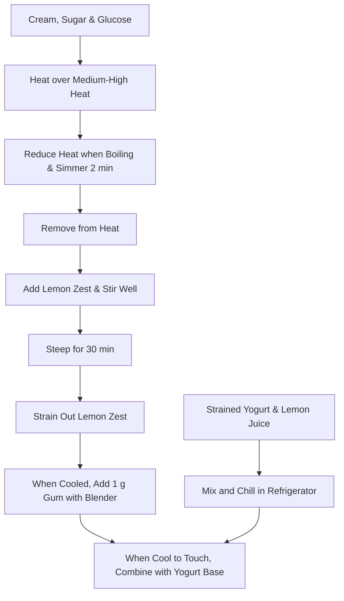

# Lemon Ice Cream

> [!info] Recipe Summary
> A refreshing yogurt-based lemon ice cream recipe prepared with fresh lemon juice and lemon zest.

## Ingredients

| Ingredient | Amount | Notes |
| :--- | :--- | :--- |
| Strained Yogurt | 400 g | |
| Lemon Juice | 150 g | About 3/4 cup (~6 lemons) |
| Heavy Cream | 200 g | |
| Sugar | 200 g | |
| Glucose | 50 g | |
| Lemon Zest | 6 g | Stir well |
| Gum (Stabilizer) | 1 g | Blend into cream/zest mixture once cooled |

## Instructions

### 1. Yogurt & Lemon Base
1. Mix **Strained Yogurt** and fresh **Lemon Juice** until smooth.
2. Place the mixture in the refrigerator to chill.

### 2. Syrup Preparation and Infusing Zest
1. Heat **Heavy Cream**, **Sugar**, and **Glucose** over medium-high heat.
2. Once the mixture comes to a boil, reduce the heat and simmer for 2 minutes. Then remove from heat.
3. Stir the **lemon zest** into the hot mixture and mix well. Let steep for 30 minutes.
4. After 30 minutes, strain out the lemon zest.
5. When the cream/zest syrup has cooled completely, add **1 g gum** and blend thoroughly with a blender.

### 3. Combining
1. When the syrup mixture has cooled down to lukewarm/room temperature, combine it with the chilled yogurt mixture from the refrigerator and mix thoroughly.

---

## Workflow (Flowchart)

