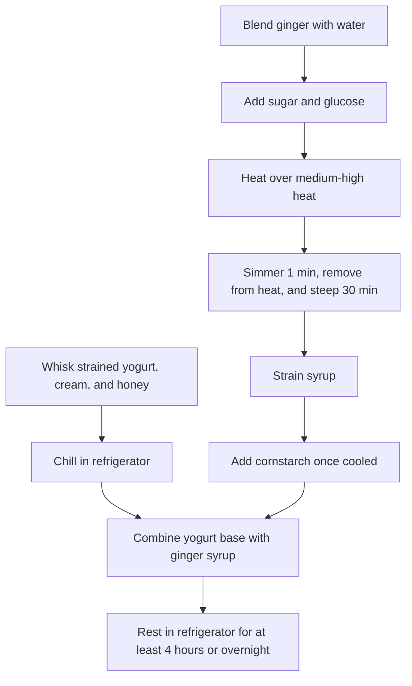

# Ginger Ice Cream

> [!NOTE]
> **Recipe Summary**  
> A refreshing ice cream recipe made with fresh ginger infusion, strained yogurt, and cream.

## Ingredients

| Ingredient | Amount | Notes |
| :--- | :--- | :--- |
| Strained yogurt | 400 g | - |
| Heavy cream | 200 g | - |
| Honey | 50 g | - |
| Fresh ginger | 50 g | Chopped pea-sized |
| Water | 150 g | - |
| Sugar | 150 g | - |
| Glucose | 50 g | - |
| Cornstarch | 10 g | - |

## Instructions

{}
1. ## Prepare the Yogurt Base
   Whisk the strained yogurt, heavy cream, and honey until smooth. Place the mixture in the refrigerator to chill.

2. ## Cook the Ginger Syrup
   Blend the pea-sized fresh ginger with the water in a blender until finely chopped. Transfer the mixture to a saucepan; add the sugar and glucose. Heat over medium-high heat until boiling, then lower the heat, simmer gently for 1 minute, and turn off the heat.

3. ## Steep and Add Cornstarch
   Let steep for 30 minutes, then strain the syrup. Once the syrup cools to lukewarm/room temperature, whisk in the cornstarch.

4. ## Combine and Chill
   Combine the ginger syrup with the chilled yogurt base and mix thoroughly. Chill the ice cream base in the refrigerator for at least 4 hours, preferably overnight.
{}

## Workflow

