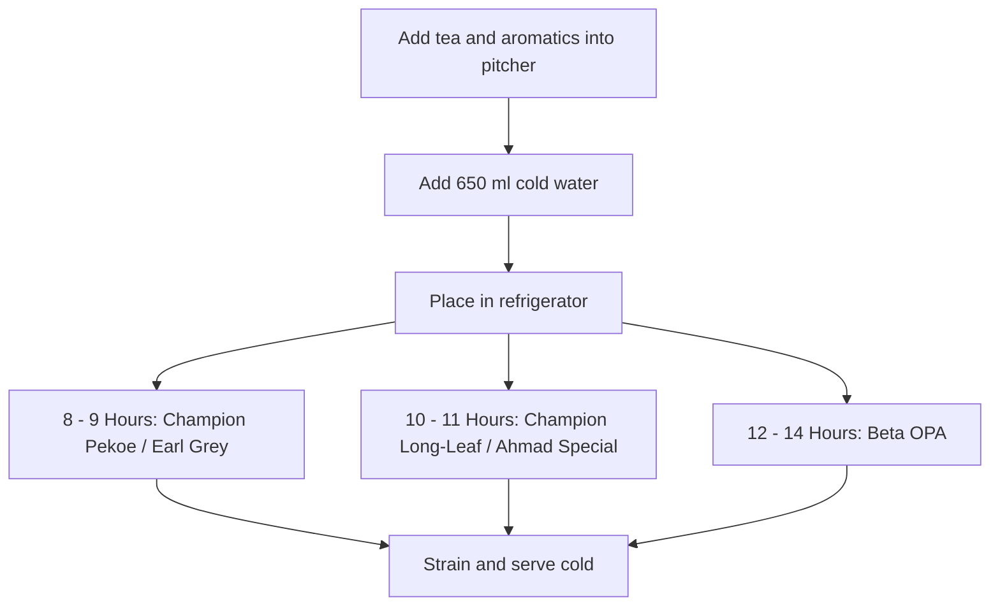

# Cold Brew Tea Recipes

> [!NOTE]
> **Recipe Summary**  
> A refreshing cold brew tea guide prepared with different tea varieties (Beta OPA, Champion Pekoe, Champion Long-Leaf, Ahmad Special, Earl Grey) and natural aromatics.

## Ingredients

| Ingredient | Amount | Notes |
| :--- | :--- | :--- |
| Tea (By variety) | 8–12 g | Beta OPA (12 g), Champion Pekoe (8 g), Champion Long-Leaf (10 g), Ahmad Special (10 g), or Earl Grey (8 g) |
| Cold water | 650 ml | Standard water volume for each brew |
| Cloves | 2–3 | Beta OPA (2 crushed), Champion Pekoe (2), or Earl Grey (3) |
| Cinnamon sticks | 2 sticks | For Champion Pekoe or Ahmad Special |
| Lemon peel / slices | Half peel / 2 slices | Beta OPA (peel of half lemon) or Earl Grey (2 lemon slices) |
| Fresh ginger | Coin-sized slice | For Champion Long-Leaf |
| Fresh mint | 5–6 leaves | For Champion Long-Leaf |
| Orange peel | 1 strip | For Ahmad Special |

## Instructions

{}
1. ## Prep Tea and Aromatics
   Add your selected tea variety and the corresponding spices/fruits (crushed cloves, cinnamon stick, citrus peel, ginger, or mint) into a brewing pitcher.

2. ## Add Cold Water
   Pour 650 ml of cold water into the pitcher and gently stir so all leaves and aromatics are submerged.

3. ## Cold Brew in the Refrigerator
   Cover the pitcher and place in the refrigerator. Steep according to the specific tea variety:
   - **Champion Pekoe & Earl Grey:** 8–9 hours
   - **Champion Long-Leaf & Ahmad Special:** 10–11 hours
   - **Beta OPA:** 12–14 hours

4. ## Strain and Serve
   Once steeping is complete, pour the tea through a fine mesh strainer. Serve cold, over ice if desired.
{}

## Workflow

